<div align="center">

# 🎬 IMDB Sentiment Analysis with RNN, LSTM & GRU

### 🧠 Deep Learning PR-5 · End-to-End Sequence Modeling Project


<br>


<br>

**A practical study of recurrent neural networks for binary movie-review sentiment classification.**

</div>

---

## 🌟 Project at a Glance

<table>
<tr>
<td align="center"><b>🎞️ Dataset</b><br>IMDB Movie Reviews</td>
<td align="center"><b>🧹 Clean Reviews</b><br>49,582</td>
<td align="center"><b>🏋️ Training Samples</b><br>39,665</td>
<td align="center"><b>🧪 Test Samples</b><br>9,917</td>
</tr>
<tr>
<td align="center"><b>🔤 Vocabulary</b><br>10,000</td>
<td align="center"><b>📏 MAXLEN</b><br>600</td>
<td align="center"><b>🤖 Models</b><br>5</td>
<td align="center"><b>🏆 Best Model</b><br>GRU</td>
</tr>
</table>

> **Final GRU result:** **89.73% test accuracy**, **89.78% F1**, and **0.9595 ROC-AUC**.

---

<div align="center">

## 🎬 Live Project Demo


<br><br>

<a href="https://drive.google.com/file/d/1UzkkxfxpbbI28iUOEXHBU3aXa_b8GlC8/view?usp=sharing">
  
</a>

<br><br>

<b>🎥 Watch the complete Sentiment Analysis project demonstration</b>

<br>

<sub>✨ Data Preprocessing • SimpleRNN • LSTM • GRU • Model Comparison • Live Prediction ✨</sub>

</div>

---

# 📌 Project Overview

This notebook implements **sentiment analysis on IMDB movie reviews** and progressively builds understanding from basic text preprocessing to gated recurrent neural networks.

The work is organized into seven main tasks:

1. **Text Loading, Cleaning, Tokenisation & Padding**
2. **RNN Intuition, ANN Baseline & Manual Forward Propagation**
3. **Types of RNN & SimpleRNN Sentiment Analysis**
4. **Backpropagation Through Time, Vanishing & Exploding Gradients**
5. **Long Short-Term Memory (LSTM)**
6. **Gated Recurrent Unit (GRU)**
7. **Final Comparison, Error Analysis & Inference**

The project does more than compare accuracy. It also studies **hidden states, parameter counts, gradient behaviour, sequence length, gradient clipping, review length, false positives/false negatives, and custom text inference**.

---

# 🎯 Business / ML Problem

Movie-review platforms contain large amounts of written feedback. Reading every review manually is slow and difficult at scale.

The machine-learning problem is:

> **Given the text of a movie review, predict whether its sentiment is Positive or Negative.**

This is a **binary many-to-one sequence-classification problem**:

```text
Many words / tokens
        ↓
One sentiment label
```

---

# 🗂️ Dataset

The notebook uses the **IMDB Dataset of 50K Movie Reviews**.

🔗 [Kaggle — IMDB Dataset of 50K Movie Reviews](https://www.kaggle.com/datasets/lakshmi25npathi/imdb-dataset-of-50k-movie-reviews)

The main source columns are:

| Column | Meaning |
|---|---|
| `review` | Raw movie-review text |
| `sentiment` | `positive` or `negative` |

After duplicate removal and feature preparation, the notebook reports:

```text
Dataset Shape    : (49,582, 5)
Training Samples : 39,665
Testing Samples  : 9,917
Vocabulary Size  : 10,000
MAXLEN           : 600
```

---

# 🔄 Complete Workflow

```text
                    ┌──────────────────────┐
                    │   Raw IMDB Reviews   │
                    └──────────┬───────────┘
                               ↓
                    ┌──────────────────────┐
                    │ Remove Duplicates    │
                    └──────────┬───────────┘
                               ↓
                    ┌──────────────────────┐
                    │   Clean Raw Text     │
                    └──────────┬───────────┘
                               ↓
                    ┌──────────────────────┐
                    │ Review-Length Study  │
                    └──────────┬───────────┘
                               ↓
                    ┌──────────────────────┐
                    │ Train / Test Split   │
                    └──────────┬───────────┘
                               ↓
                    ┌──────────────────────┐
                    │ Training Tokenizer   │
                    └──────────┬───────────┘
                               ↓
                    ┌──────────────────────┐
                    │ Sequences + Padding  │
                    └──────────┬───────────┘
                               ↓
            ┌──────────────────┼───────────────────┐
            ↓                  ↓                   ↓
       ANN Baseline        SimpleRNN          Gated RNNs
                                                   │
                                        ┌──────────┴─────────┐
                                        ↓                    ↓
                                      LSTM                  GRU
                                        ↓
                                  Stacked LSTM
            └──────────────────┬───────────────────┘
                               ↓
                    ┌──────────────────────┐
                    │  Final Evaluation    │
                    └──────────┬───────────┘
                               ↓
              ROC · Length · Errors · Inference
```

---

# 🧹 Task 1 — Text Loading, Cleaning, Tokenisation & Padding

## 🎯 Objective

Prepare the raw IMDB text for deep-learning sequence models while avoiding data leakage.

## 1.1 Load and Inspect the Dataset

The notebook loads the CSV with Pandas, checks its shape and columns, and prints raw review examples.

## 1.2 Remove Duplicate Reviews

Duplicate reviews are removed **before the train/test split**.

Why?

If the same review appears in both training and test data, the model may already have seen the test example during training. This can produce artificially optimistic evaluation results.

## 1.3 Text Cleaning

The notebook defines a reusable `clean_text()` function that:

- converts text to lowercase;
- removes HTML tags;
- removes unwanted non-alphabetic characters;
- preserves apostrophes;
- normalizes repeated whitespace.

Apostrophes are intentionally preserved because contractions such as:

```text
don't
isn't
wasn't
can't
```

can carry important negation information.

Stop words are **not removed** because sequence models depend on word order and context. Words such as `not` may be crucial for sentiment.

## 1.4 Review-Length Analysis

The notebook calculates review lengths and studies their distribution using a histogram and boxplot.

<div align="center">
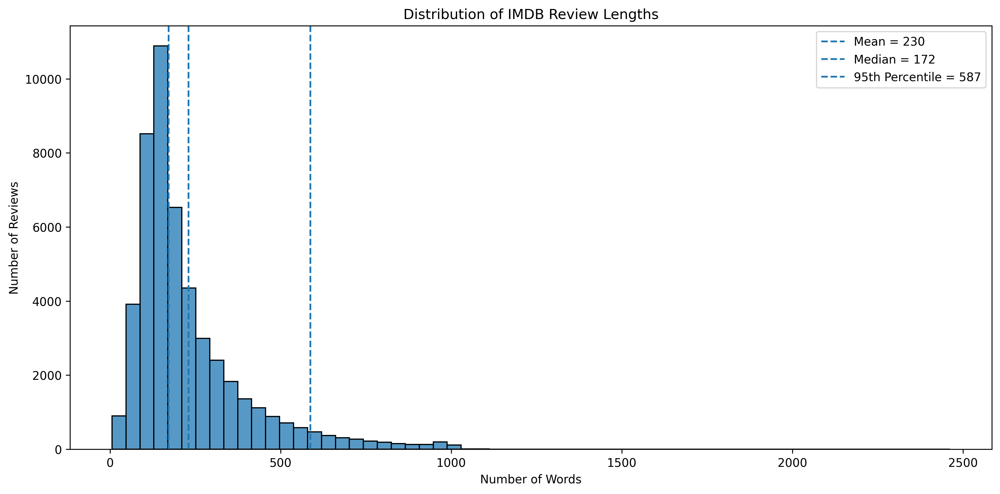
</div>

The notebook chooses:

```text
MAXLEN = 600
```

based approximately on the 95th percentile of review length and rounds it to a convenient value.

This balances two needs:

- retain most useful review content;
- avoid excessive padding and unnecessary computation.

## 1.5 Encode the Target

```text
negative → 0
positive → 1
```

## 1.6 Split Before Fitting the Tokenizer

A key leakage-prevention step is:

```text
Clean Reviews
     ↓
Train/Test Split
     ↓
Fit Tokenizer on Training Text Only
```

The tokenizer therefore learns its vocabulary only from training data.

## 1.7 Tokenisation

The tokenizer uses:

```python
VOCAB_SIZE = 10000
oov_token = "<OOV>"
```

Text is converted into integer sequences:

```text
"this movie is amazing"
           ↓
[integer, integer, integer, integer]
```

The `<OOV>` token represents words outside the learned vocabulary.

## 1.8 Padding

The notebook uses:

```python
padding="pre"
truncating="pre"
```

With pre-padding, zeros are added at the beginning of shorter sequences, keeping the most recent real tokens near the end of the sequence.

## 1.9 Why Text Is Sequential

Consider:

```text
"The movie was not good."
"The movie was good, not bad."
```

The words are similar, but their **order and context change the meaning**. This is why sequence models are useful.

### ✅ Task 1 Result

The raw reviews are converted into fixed-length integer sequences suitable for neural-network training.

---

# 🧠 Task 2 — ANN Baseline, RNN Intuition & Manual Forward Propagation

## 🎯 Objective

Create a baseline classifier and understand the internal forward computation of a SimpleRNN.

## 2.1 ANN Baseline

Architecture:

```text
Padded Review
     ↓
Embedding
     ↓
Flatten
     ↓
Dense(64, ReLU)
     ↓
Dense(1, Sigmoid)
     ↓
Positive / Negative
```

The ANN provides a useful reference model before recurrent architectures are introduced.

### Final ANN Result

| Metric | Result |
|---|---:|
| Test Accuracy | **86.62%** |
| Precision | **86.63%** |
| Recall | **86.72%** |
| F1 | **86.68%** |
| ROC-AUC | **0.9379** |
| Total Parameters | **1,548,929** |
| Time / Epoch | **12.60 s** |

The ANN performs strongly, but the Flatten layer does not naturally reuse a recurrent transition across sequence positions.

## 2.2 RNN Intuition

A SimpleRNN processes a sequence one time step at a time.

Its hidden state is:

\[
h_t = \tanh(W_{xh}x_t + W_{hh}h_{t-1} + b)
\]

where:

- \(x_t\): current input;
- \(h_{t-1}\): previous hidden state;
- \(W_{xh}\): input-to-hidden weights;
- \(W_{hh}\): recurrent hidden-to-hidden weights;
- \(b\): bias;
- \(h_t\): new hidden state.

## 2.3 Manual NumPy RNN

The notebook manually implements a tiny RNN using NumPy with:

```text
Input Size     = 2
Hidden Size    = 3
Sequence Steps = 4
```

At each step:

```text
Current Input + Previous Hidden State
                  ↓
            Linear Transform
                  ↓
                 tanh
                  ↓
           New Hidden State
```

## 2.4 Hidden-State Heatmap

<div align="center">
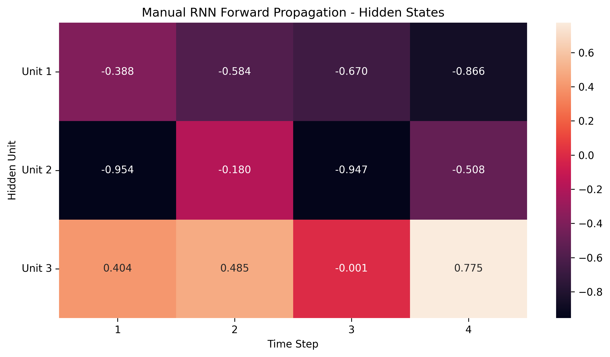
</div>

The heatmap visualizes how hidden-unit values evolve across the four time steps.

## 2.5 Verify NumPy Against Keras

The notebook creates a Keras `SimpleRNN`, copies the manual NumPy weights into it, runs the same input sequence, and compares outputs.

This verifies that the manual forward equations match Keras behaviour.

## 2.6 Parameter Count

For a `SimpleRNN(64)` receiving a 32-dimensional embedding:

\[
Parameters = units \times (input\_dim + units + 1)
\]

\[
64 \times (32 + 64 + 1)=6208
\]

### ✅ Task 2 Result

This task connects RNN mathematics with an actual Keras implementation and establishes the ANN baseline.

---

# 🔁 Task 3 — Types of RNN & SimpleRNN Sentiment Analysis

## 🎯 Objective

Understand common sequence input/output patterns and build the first recurrent sentiment classifier.

## 3.1 Four Sequence Mapping Types

| Type | Meaning | Example |
|---|---|---|
| One-to-One | One input → one output | Image classification |
| One-to-Many | One input → sequence | Caption generation |
| Many-to-One | Sequence → one output | **Sentiment analysis** |
| Many-to-Many | Sequence → sequence | Sequence labeling |

This project is **Many-to-One**:

```text
Review Token 1 ─┐
Review Token 2  │
Review Token 3  ├──→ Sentiment
...             │
Review Token N ─┘
```

## 3.2 Reusable Model Builder

The notebook creates one reusable `build_model()` function supporting:

```text
rnn
lstm
gru
```

This keeps the experimental pipeline consistent when the recurrent cell changes.

## 3.3 SimpleRNN Architecture

```text
Input
  ↓
Embedding(10,000, 32)
  ↓
SimpleRNN(64)
  ↓
Dense(1, Sigmoid)
  ↓
Sentiment
```

## 3.4 Training

The model uses:

- Adam optimizer;
- binary cross-entropy;
- batch size 64;
- validation split;
- EarlyStopping;
- best-weight restoration;
- a custom callback for time per epoch.

## 3.5 Training Curves

<div align="center">
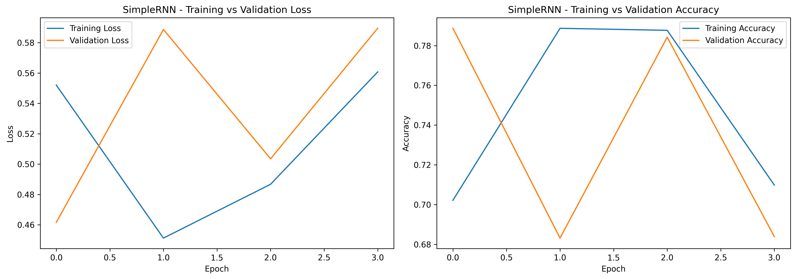
</div>

## 3.6 Evaluation

<div align="center">
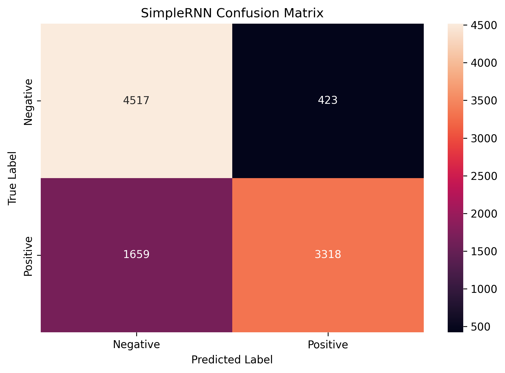
</div>

### Final SimpleRNN Result

| Metric | Result |
|---|---:|
| Test Accuracy | **79.01%** |
| Precision | **88.69%** |
| Recall | **66.67%** |
| F1 | **76.12%** |
| ROC-AUC | **0.8787** |
| Total Parameters | **326,273** |
| Epochs | **4** |

The model has relatively high precision but much lower recall, meaning it misses a substantial number of actual positive reviews.

## 3.7 Learned Embeddings

The notebook inspects the learned embedding matrix and retrieves vectors for words such as `good` and `bad`.

### ✅ Task 3 Result

The project now has a complete recurrent baseline for later comparison with gated architectures.

---

# 📉 Task 4 — BPTT, Vanishing Gradients & Exploding Gradients

## 🎯 Objective

Understand how recurrent networks learn through time and why basic RNNs can struggle with long sequences.

## 4.1 Backpropagation Through Time

An RNN can be visualized as:

```text
x₁ → h₁ → h₂ → h₃ → ... → hₜ → Prediction
```

During BPTT, the loss gradient travels backward through these recurrent steps.

Repeated multiplication of recurrent transformations and activation derivatives can cause gradient magnitude to shrink or grow dramatically.

## 4.2 Vanishing Gradient

When repeated gradient factors are small:

```text
0.5 × 0.5 × 0.5 × 0.5 × ...
```

the gradient can approach zero.

**Effect:** information from early time steps becomes difficult to learn.

## 4.3 Exploding Gradient

When repeated factors are large, gradients may grow excessively.

Possible symptoms:

- unstable loss;
- huge updates;
- numerical instability;
- NaN values.

## 4.4 Gradient-Norm Experiment

The notebook uses TensorFlow `GradientTape` to inspect gradient norms.

<div align="center">
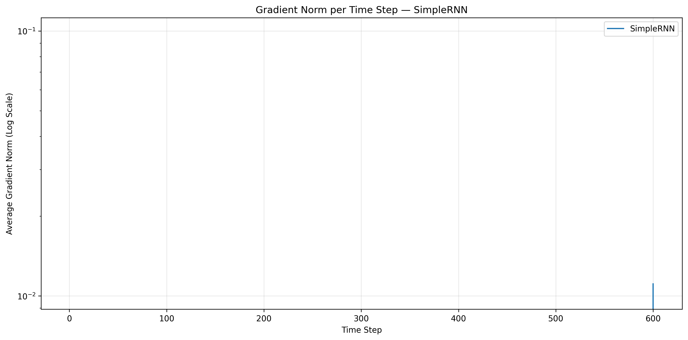
</div>

The notebook's direct hidden-output gradient experiment reports zero values at many earlier positions and a non-zero gradient at the final position. This result should be interpreted according to the exact computation used in the notebook rather than treated as a universal gradient-decay curve.

## 4.5 Sequence-Length Experiment

SimpleRNN is tested with:

```text
50
100
200
300
```

time steps.

<div align="center">
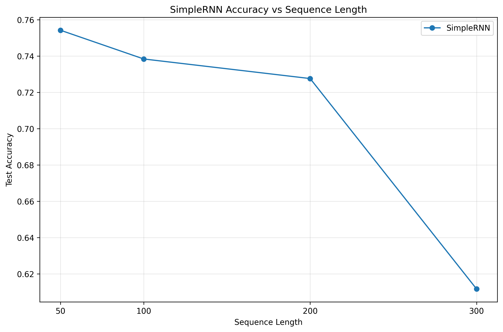
</div>

This experiment studies the trade-off between retaining more review context and making recurrent optimization more difficult.

## 4.6 Gradient Clipping

The notebook compares a high-learning-rate RNN:

```text
Without Gradient Clipping
            vs
Adam(..., clipnorm=1.0)
```

<div align="center">
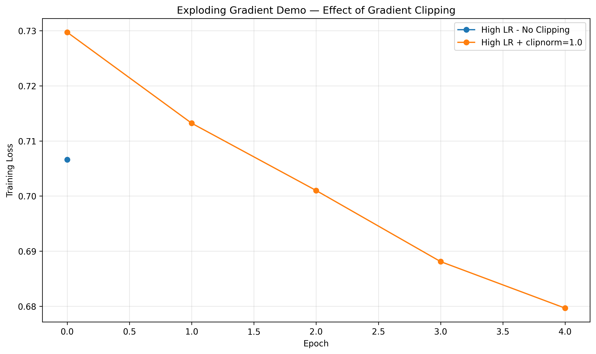
</div>

Gradient clipping is mainly used to control **exploding gradients**.

### ✅ Task 4 Result

This task explains the motivation for LSTM and GRU: basic recurrence can struggle to carry useful learning signals across long sequences.

---

# 🧠 Task 5 — Long Short-Term Memory (LSTM)

## 🎯 Objective

Understand LSTM memory gates, implement the cell manually, and evaluate single and stacked LSTM models.

## 5.1 LSTM Gates

LSTM maintains both:

```text
Hidden State hₜ
Cell State   Cₜ
```

### Forget Gate

\[
f_t = \sigma(W_f[h_{t-1},x_t]+b_f)
\]

Controls what previous memory should be retained.

### Input Gate

\[
i_t = \sigma(W_i[h_{t-1},x_t]+b_i)
\]

Controls how much new information should be written.

### Candidate State

\[
g_t = \tanh(W_g[h_{t-1},x_t]+b_g)
\]

Creates candidate information.

### Cell-State Update

\[
C_t=f_tC_{t-1}+i_tg_t
\]

### Output Gate

\[
o_t=\sigma(W_o[h_{t-1},x_t]+b_o)
\]

### Hidden State

\[
h_t=o_t\tanh(C_t)
\]

## 5.2 Why LSTM Helps

The additive cell-state path provides a more direct route for memory.

When the forget gate is close to one, previous cell-state information can be retained across more time steps.

## 5.3 LSTM Recurrent Parameter Count

For 64 units and 32 input features:

\[
4 \times 64 \times (32+64+1)=24,832
\]

The four comes from the forget, input, candidate, and output transformations.

## 5.4 Manual LSTM

The notebook manually implements an LSTM using NumPy with:

```text
Input Size  = 2
Hidden Size = 3
Time Steps  = 4
```

At every time step it calculates:

```text
Forget Gate
Input Gate
Candidate State
Cell State
Output Gate
Hidden State
```

## 5.5 Train LSTM

```text
Embedding(10,000, 32)
          ↓
       LSTM(64)
          ↓
 Dense(1, Sigmoid)
```

<div align="center">
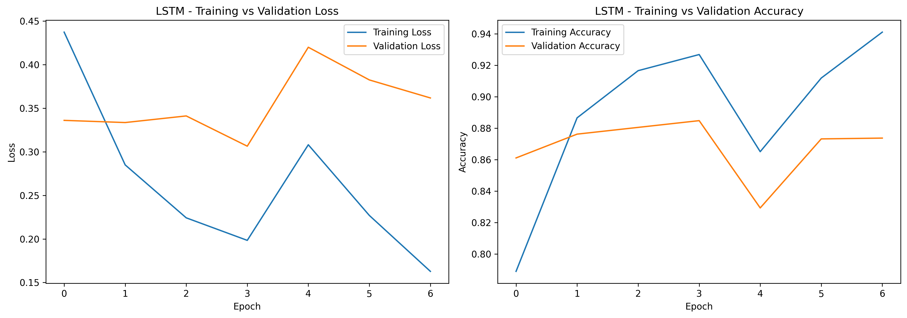
</div>

<div align="center">
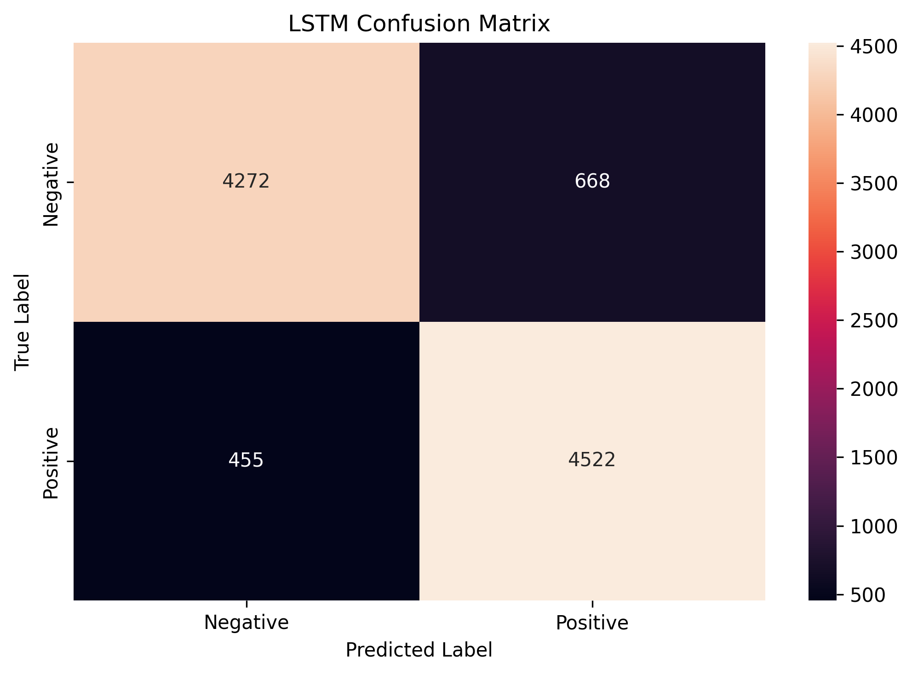
</div>

### Final LSTM Result

| Metric | Result |
|---|---:|
| Test Accuracy | **88.68%** |
| Precision | **87.13%** |
| Recall | **90.86%** |
| F1 | **88.95%** |
| ROC-AUC | **0.9497** |
| Total Parameters | **344,897** |
| Epochs | **7** |

## 5.6 RNN vs LSTM Gradient Experiment

<div align="center">
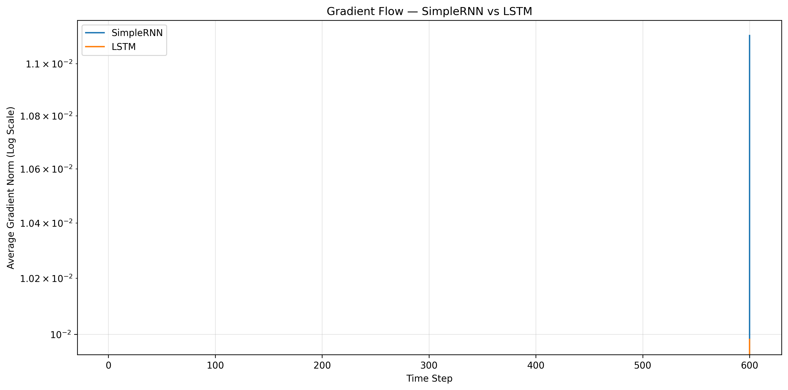
</div>

## 5.7 Stacked LSTM

Architecture:

```text
Embedding
   ↓
LSTM(64, return_sequences=True)
   ↓
LSTM(32)
   ↓
Dense(1, Sigmoid)
```

The first LSTM uses `return_sequences=True` because the second recurrent layer requires the full sequence of hidden outputs.

### Final Stacked LSTM Result

| Metric | Result |
|---|---:|
| Test Accuracy | **88.31%** |
| Precision | **88.58%** |
| Recall | **88.07%** |
| F1 | **88.32%** |
| ROC-AUC | **0.9499** |
| Total Parameters | **357,281** |
| Epochs | **6** |

The deeper model did not outperform the single LSTM or GRU in this notebook.

### ✅ Task 5 Result

LSTM substantially improves the final metrics over SimpleRNN and demonstrates explicit gated memory.

---

# 🚀 Task 6 — Gated Recurrent Unit (GRU)

## 🎯 Objective

Study the simpler gated GRU architecture and compare it with LSTM.

## 6.1 GRU Gates

GRU uses two primary gates.

### Update Gate

\[
z_t=\sigma(W_z[h_{t-1},x_t]+b_z)
\]

Controls the balance between old and new information.

### Reset Gate

\[
r_t=\sigma(W_r[h_{t-1},x_t]+b_r)
\]

Controls how much previous hidden information is used to construct the candidate.

### Candidate Hidden State

\[
\tilde{h}_t=\tanh(W_h[r_t*h_{t-1},x_t]+b_h)
\]

### Final Hidden State

\[
h_t=(1-z_t)h_{t-1}+z_t\tilde{h}_t
\]

## 6.2 LSTM vs GRU

| Feature | LSTM | GRU |
|---|---|---|
| Main gates | Forget, Input, Output | Update, Reset |
| Separate cell state | Yes | No |
| Architecture | More complex | Simpler |
| Recurrent parameters in this setup | 24,832 | 18,816 |
| Memory | Cell + hidden state | Hidden state |

## 6.3 GRU Recurrent Parameter Count

With Keras `reset_after=True`:

\[
3 \times (64\times32 + 64\times64 + 2\times64)=18,816
\]

## 6.4 Train GRU

```text
Embedding(10,000, 32)
          ↓
        GRU(64)
          ↓
 Dense(1, Sigmoid)
```

<div align="center">
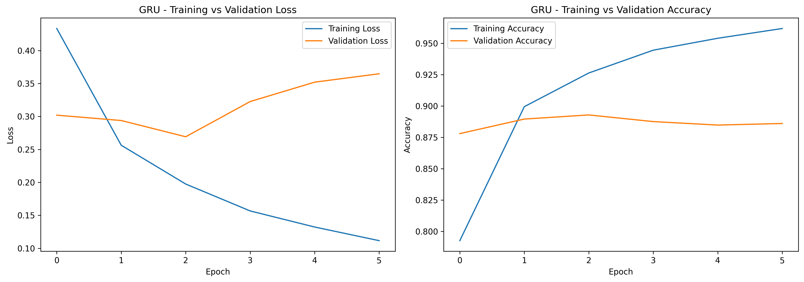
</div>

<div align="center">
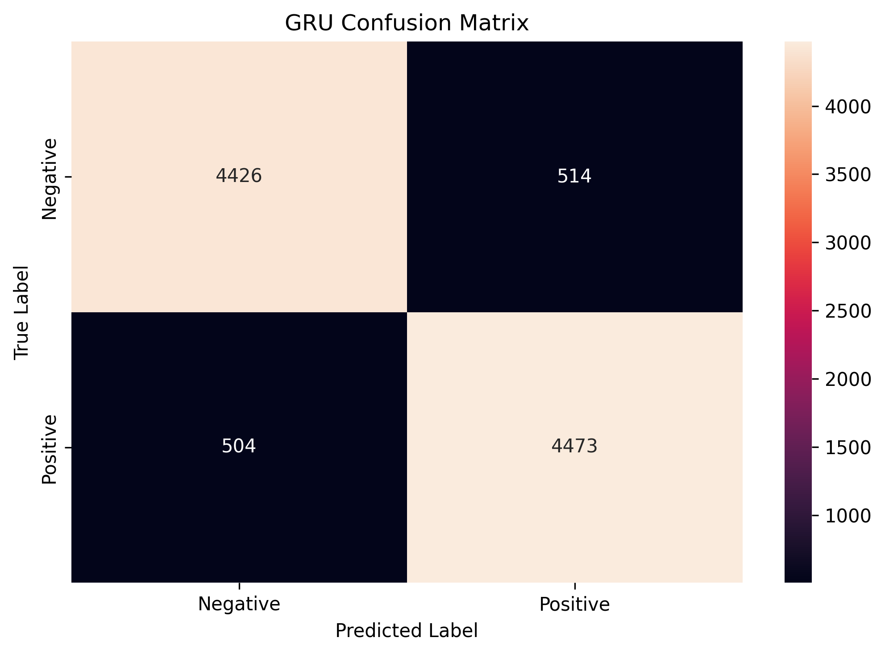
</div>

### Final GRU Result 🏆

| Metric | Result |
|---|---:|
| Test Accuracy | **89.73%** |
| Precision | **89.69%** |
| Recall | **89.87%** |
| F1 | **89.78%** |
| ROC-AUC | **0.9595** |
| Total Parameters | **338,881** |
| Epochs | **6** |

## 6.5 RNN vs LSTM vs GRU Gradient Experiment

<div align="center">
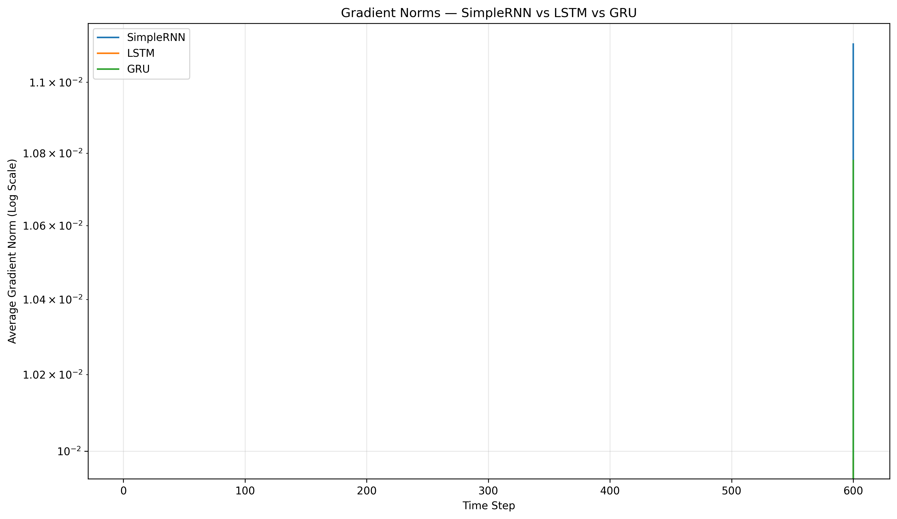
</div>

The recorded table in the notebook shows zero direct hidden-output gradient at the first and middle inspected positions for all three architectures, with non-zero values at the final position. This reflects the exact GradientTape experiment used in the notebook.

## 6.6 Hidden-Unit Sensitivity

LSTM and GRU are retrained using:

```text
32 units
64 units
128 units
```

### Experiment Results

| Cell | Units | Parameters | Test Accuracy |
|---|---:|---:|---:|
| LSTM | 32 | 328,353 | 86.86% |
| LSTM | 64 | 344,897 | 87.35% |
| LSTM | 128 | 402,561 | 86.28% |
| GRU | 32 | 326,369 | 88.13% |
| GRU | 64 | 338,881 | 87.56% |
| **GRU** | **128** | **382,337** | **88.85%** |

<div align="center">
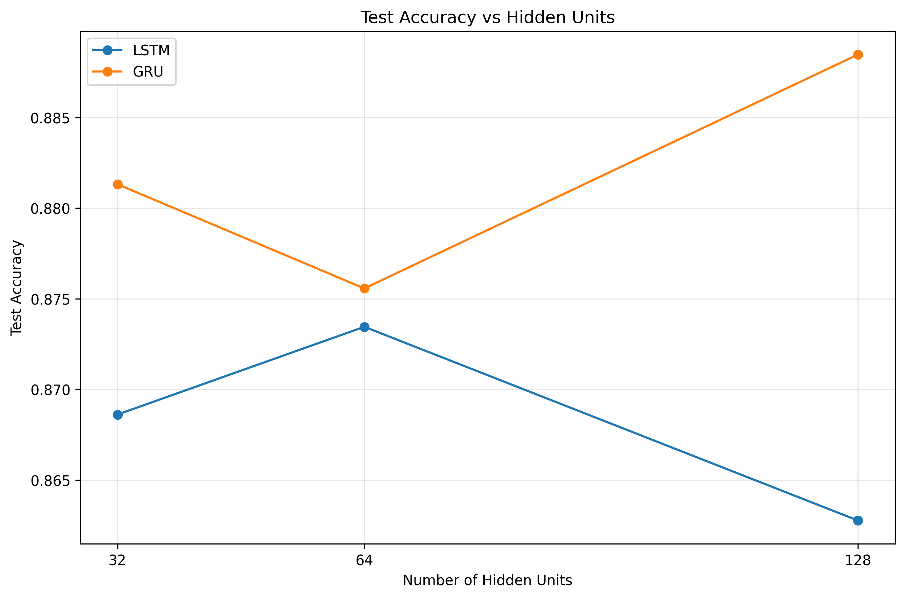
</div>

<div align="center">
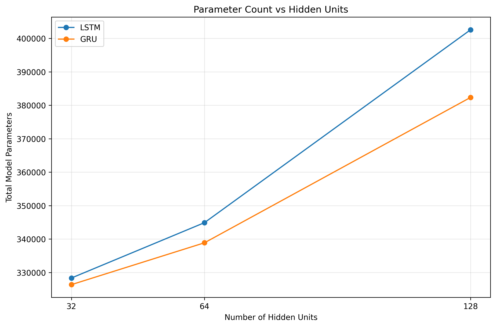
</div>

The best configuration **inside this fixed six-model sensitivity experiment** is GRU with 128 units at **88.85%** test accuracy.

This is separate from the main EarlyStopping model comparison, where the final GRU(64) model achieved **89.73%**.

### ✅ Task 6 Result

GRU provides the strongest final recurrent result in the notebook while remaining smaller than the corresponding LSTM model.

---

# 🏆 Task 7 — Final Comparison, Analysis & Inference

## 🎯 Objective

Compare every trained model and investigate performance beyond a single accuracy value.

---

## 7.1 Final Model Comparison

| Model | Parameters | Time / Epoch | Epochs | Accuracy | Precision | Recall | F1 | ROC-AUC |
|---|---:|---:|---:|---:|---:|---:|---:|---:|
| ANN Baseline | 1,548,929 | 12.60 s | 5 | 86.62% | 86.63% | 86.72% | 86.68% | 0.9379 |
| SimpleRNN | 326,273 | 68.88 s | 4 | 79.01% | 88.69% | 66.67% | 76.12% | 0.8787 |
| LSTM | 344,897 | 179.99 s | 7 | 88.68% | 87.13% | **90.86%** | 88.95% | 0.9497 |
| Stacked LSTM | 357,281 | 1358.36 s | 6 | 88.31% | 88.58% | 88.07% | 88.32% | 0.9499 |
| **GRU 🏆** | **338,881** | **174.53 s** | **6** | **89.73%** | **89.69%** | 89.87% | **89.78%** | **0.9595** |

<div align="center">
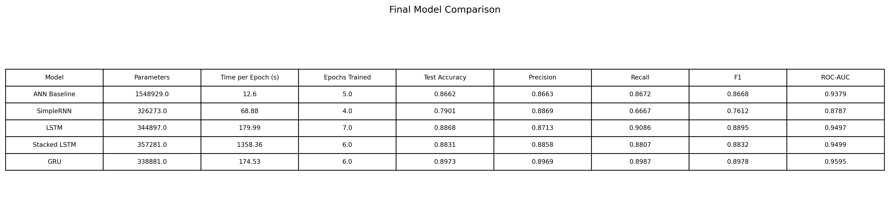
</div>

### Key Observations

- **GRU has the highest test accuracy.**
- **GRU has the highest F1 score.**
- **GRU has the highest ROC-AUC.**
- **LSTM has the highest recall.**
- **ANN has the fastest recorded time per epoch.**
- **SimpleRNN has the weakest accuracy and recall in the final comparison.**
- **Stacked LSTM adds complexity without beating the single LSTM or GRU here.**

---

## 7.2 Combined ROC Analysis

<div align="center">
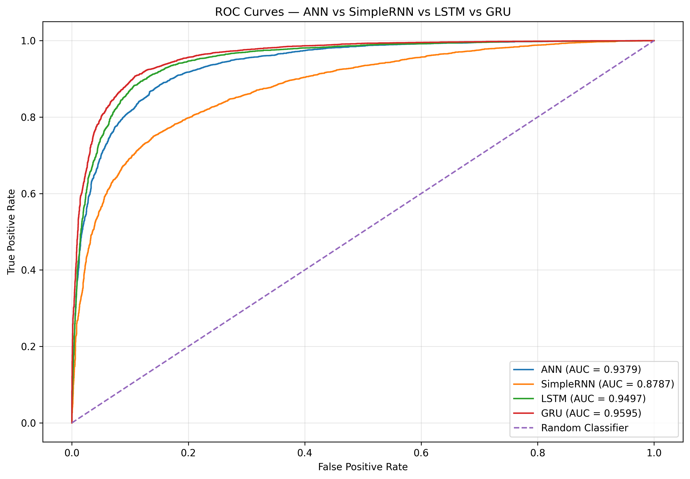
</div>

ROC-AUC measures how well the model separates positive and negative classes across thresholds.

| Model | ROC-AUC |
|---|---:|
| ANN | 0.9379 |
| SimpleRNN | 0.8787 |
| LSTM | 0.9497 |
| Stacked LSTM | 0.9499 |
| **GRU** | **0.9595** |

The final GRU has the strongest discrimination in this experiment.

---

## 7.3 Accuracy by Review Length

The notebook divides test reviews into:

```text
Short  : < 100 words
Medium : 100–250 words
Long   : > 250 words
```

It compares SimpleRNN with the best gated model, **GRU**.

| Review Length | SimpleRNN | GRU |
|---|---:|---:|
| Short (<100) | 78.83% | **90.17%** |
| Medium (100–250) | 80.20% | **89.98%** |
| Long (>250) | 76.67% | **89.05%** |

<div align="center">
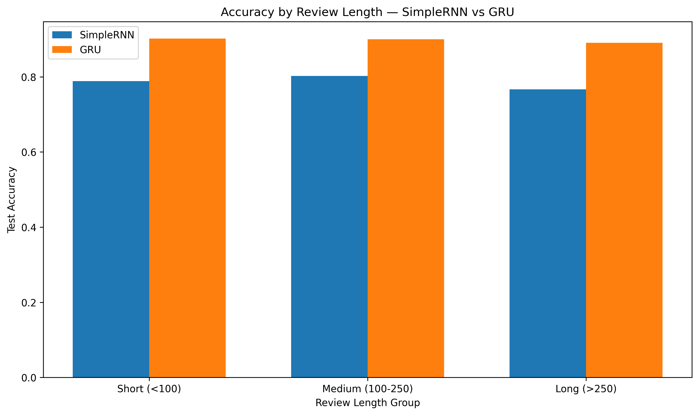
</div>

### Interpretation

GRU outperforms SimpleRNN in **all three review-length groups**.

The largest practical benefit is visible for long reviews, where SimpleRNN falls to about **76.67%**, while GRU remains around **89.05%**.

This supports the usefulness of gated recurrence for this dataset, especially when more context must be processed.

---

## 7.4 Misclassification Analysis

The notebook uses GRU for error analysis.

It finds:

```text
False Positives : 514
False Negatives : 504
```

Eight examples are selected:

```text
4 False Positives
4 False Negatives
```

### False Positive

```text
True Label      : Negative
Predicted Label : Positive
```

### False Negative

```text
True Label      : Positive
Predicted Label : Negative
```

The notebook displays for each example:

- error type;
- true label;
- predicted label;
- positive-class probability;
- cleaned review text.

The selected probabilities include:

| Error | Positive Probability |
|---|---:|
| False Positive 1 | 0.6195 |
| False Positive 2 | 0.7703 |
| False Positive 3 | 0.7146 |
| False Positive 4 | 0.6687 |
| False Negative 1 | 0.3560 |
| False Negative 2 | 0.1355 |
| False Negative 3 | 0.0753 |
| False Negative 4 | 0.4830 |

Possible difficulties visible in natural review text include mixed opinions, negation, long context, ambiguous phrasing and sentiment shifts.

---

## 7.5 Reusable `predict_sentiment()` Function

The notebook creates a user-friendly inference function.

```python
predict_sentiment(text)
```

Pipeline:

```text
New Review
    ↓
clean_text()
    ↓
Training Tokenizer
    ↓
Integer Sequence
    ↓
Pre-Padding to MAXLEN = 600
    ↓
GRU Prediction
    ↓
Positive Probability
    ↓
Threshold 0.5
    ↓
Positive / Negative
```

Example notebook test:

```python
predict_sentiment(
    "This movie was absolutely wonderful and I loved it."
)
```

Notebook output:

```python
{
    'label': 'Positive',
    'positive_probability': 0.9850381016731262
}
```

---

## 7.6 Six Custom Language Tests

The notebook evaluates six user-style sentences.

| Type | Prediction | Positive Probability |
|---|---|---:|
| Clearly Positive | Positive | **0.9787** |
| Clearly Negative | Negative | **0.0053** |
| Negation | Negative | **0.1630** |
| Double Negation | Negative | **0.2545** |
| Sarcastic | Negative | **0.4140** |
| Very Short | Positive | **0.9589** |

### What Do These Tests Show?

**Clearly Positive:** correctly produces a high positive probability.

**Clearly Negative:** correctly produces a very low positive probability.

**Negation:** the model correctly predicts Negative for `"The movie was not good..."`.

**Double Negation:** the model predicts Negative. This example demonstrates that more complex linguistic constructions can remain challenging.

**Sarcasm:** the model predicts Negative with probability below 0.5, showing useful behaviour on this specific sarcastic example.

**Very Short:** `"Amazing movie."` is predicted Positive with high confidence.

These custom tests are useful because ordinary test accuracy does not fully describe how a model handles difficult language patterns.

---

## 7.7 Production Recommendation

The notebook compares LSTM and GRU as final gated candidates:

| Metric | LSTM | GRU |
|---|---:|---:|
| Accuracy | 88.68% | **89.73%** |
| Precision | 87.13% | **89.69%** |
| Recall | **90.86%** | 89.87% |
| F1 | 88.95% | **89.78%** |
| ROC-AUC | 0.9497 | **0.9595** |
| Parameters | 344,897 | **338,881** |
| Time / Epoch | 179.99 s | **174.53 s** |

### 🏆 Recommended Model: GRU

GRU is selected because it provides the strongest overall balance in this notebook:

```text
Accuracy   : 89.73%
Precision  : 89.69%
Recall     : 89.87%
F1         : 89.78%
ROC-AUC    : 0.9595
Parameters : 338,881
Time/Epoch : 174.53 s
```

LSTM has slightly higher recall, but GRU wins on accuracy, precision, F1, ROC-AUC, parameter count, and recorded time per epoch.

---

# 📊 Combined Training Curves

<div align="center">
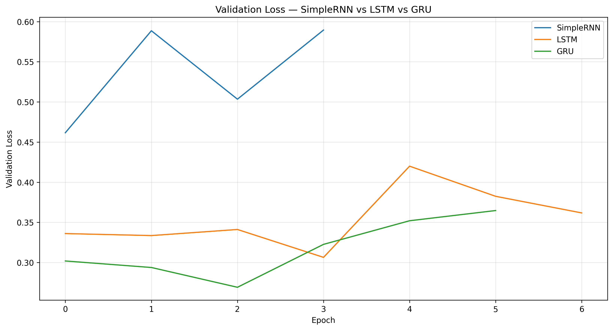
</div>

This plot provides a single view of the recurrent models' validation-loss behaviour.

---

# 🖼️ Complete Plot Gallery

All graphs generated by the notebook can be stored in the **`plots/`** folder.

| Plot | Purpose |
|---|---|
| `length_distribution.png` | Review-length distribution |
| `rnn_forward_heatmap.png` | Manual RNN hidden states |
| `training_curves_simplernn.png` | SimpleRNN learning curves |
| `confusion_matrix_simplernn.png` | SimpleRNN errors |
| `gradient_norm_simplernn.png` | SimpleRNN gradient experiment |
| `accuracy_vs_sequence_length_rnn.png` | Sequence-length sensitivity |
| `gradient_clipping_comparison.png` | Clipping experiment |
| `training_curves_lstm.png` | LSTM learning curves |
| `confusion_matrix_lstm.png` | LSTM errors |
| `gradient_norm_rnn_vs_lstm.png` | RNN vs LSTM gradient experiment |
| `training_curves_gru.png` | GRU learning curves |
| `confusion_matrix_gru.png` | GRU errors |
| `gradient_norms_all_cells.png` | RNN vs LSTM vs GRU gradients |
| `accuracy_vs_hidden_units.png` | Hidden-unit accuracy sensitivity |
| `parameters_vs_hidden_units.png` | Parameter growth with hidden units |
| `results_table.png` | Final model comparison |
| `roc_curves.png` | Combined ROC analysis |
| `accuracy_by_length.png` | Accuracy by review length |
| `training_curves_rnn_lstm_gru.png` | Combined recurrent validation curves |

---

# 📂 Recommended Repository Structure

```text
DL_PR5/
│
├── DL_PR5.ipynb
├── DL_PR5.html
├── README.md
├── requirements.txt
├── model_comparison_results.csv
│
├── data/
│   └── IMDB Dataset.csv
│
└── plots/
    ├── length_distribution.png
    ├── rnn_forward_heatmap.png
    ├── training_curves_simplernn.png
    ├── confusion_matrix_simplernn.png
    ├── gradient_norm_simplernn.png
    ├── accuracy_vs_sequence_length_rnn.png
    ├── gradient_clipping_comparison.png
    ├── training_curves_lstm.png
    ├── confusion_matrix_lstm.png
    ├── gradient_norm_rnn_vs_lstm.png
    ├── training_curves_gru.png
    ├── confusion_matrix_gru.png
    ├── gradient_norms_all_cells.png
    ├── accuracy_vs_hidden_units.png
    ├── parameters_vs_hidden_units.png
    ├── results_table.png
    ├── roc_curves.png
    ├── accuracy_by_length.png
    └── training_curves_rnn_lstm_gru.png
```

> If your notebook currently reads `"IMDB Dataset.csv"` from the project root, either keep the CSV in the root or update the notebook path before moving it into `data/`.

---

# ⚙️ Installation & Usage

## 1. Clone the Repository

```bash
git clone <YOUR-GITHUB-REPOSITORY-URL>
cd DL_PR5
```

## 2. Create a Virtual Environment

```bash
python -m venv venv
```

### Windows

```bash
venv\Scripts\activate
```

### macOS / Linux

```bash
source venv/bin/activate
```

## 3. Install Dependencies

```bash
pip install -r requirements.txt
```

## 4. Start Jupyter

```bash
jupyter notebook
```

Open:

```text
DL_PR5.ipynb
```

Then run the notebook cells from top to bottom.

---

# 📦 Requirements

The notebook creates a `requirements.txt` containing:

```text
tensorflow
scikit-learn
pandas
numpy
matplotlib
seaborn
jupyter
```

---

# 🛠️ Technologies Used

<div align="center">

| Technology | Role |
|---|---|
| 🐍 Python | Programming |
| 🧠 TensorFlow | Deep-learning framework |
| 🔥 Keras | ANN / RNN / LSTM / GRU |
| 🐼 Pandas | Dataset manipulation |
| 🔢 NumPy | Manual recurrent calculations |
| 📊 Matplotlib | Charts |
| 📉 Seaborn | Heatmaps and confusion matrices |
| 🤖 Scikit-learn | Split and evaluation metrics |
| 📓 Jupyter | Notebook development |

</div>

---

# 🧠 What This Project Demonstrates

### Text Processing
- duplicate removal;
- cleaning;
- review-length analysis;
- target encoding;
- tokenization;
- OOV handling;
- padding and truncation;
- leakage-aware train/test workflow.

### Recurrent Deep Learning
- ANN baseline;
- SimpleRNN;
- manual RNN forward propagation;
- one-to-one / one-to-many / many-to-one / many-to-many;
- LSTM;
- manual LSTM;
- Stacked LSTM;
- GRU.

### Optimization & Diagnostics
- BPTT;
- vanishing gradients;
- exploding gradients;
- GradientTape;
- gradient clipping;
- sequence-length sensitivity;
- hidden-unit sensitivity;
- EarlyStopping.

### Evaluation
- accuracy;
- precision;
- recall;
- F1;
- ROC-AUC;
- confusion matrices;
- ROC curves;
- review-length analysis;
- false-positive / false-negative analysis;
- custom text inference.

---

# 💡 Main Findings

### 1. ANN Is a Strong Baseline

The ANN reaches **86.62%** accuracy and trains quickly in the recorded run, although its Flatten-based design produces a much larger total parameter count.

### 2. SimpleRNN Struggles Most

SimpleRNN reaches **79.01%** accuracy and **66.67% recall**, the weakest final performance among the five models.

### 3. LSTM Greatly Improves Recall

LSTM reaches **90.86% recall**, the highest recall in the final comparison.

### 4. More Layers Do Not Automatically Mean Better Results

Stacked LSTM increases complexity and training time but does not beat the single LSTM or GRU.

### 5. GRU Gives the Best Overall Final Result

GRU reaches:

```text
Accuracy  : 89.73%
Precision : 89.69%
Recall    : 89.87%
F1        : 89.78%
ROC-AUC   : 0.9595
```

### 6. GRU Remains Strong Across Review Lengths

```text
Short  : 90.17%
Medium : 89.98%
Long   : 89.05%
```

while SimpleRNN falls to **76.67%** on long reviews.

---

# 🚀 Future Improvements

Possible extensions beyond the current notebook include:

- dropout and recurrent dropout;
- systematic hyperparameter tuning;
- different vocabulary sizes;
- different embedding dimensions;
- threshold optimization;
- probability calibration;
- more extensive sarcasm and negation analysis;
- deployment through Flask/FastAPI/Streamlit;
- saving the tokenizer and final trained model for production inference.

> This practical intentionally focuses on ANN, SimpleRNN, LSTM and GRU rather than Transformer or pretrained-language-model architectures.

---

# 🏁 Final Conclusion

This project builds sentiment analysis from the fundamentals of text preprocessing through increasingly capable recurrent architectures.

The notebook first prepares IMDB reviews using duplicate removal, text cleaning, train/test splitting, tokenization and padding. It then establishes an ANN baseline and manually demonstrates the hidden-state mathematics of SimpleRNN.

The BPTT experiments explore the optimization difficulties of recurrent networks, including vanishing and exploding gradients. LSTM introduces a gated cell-state mechanism, while GRU provides a simpler gated alternative.

The final comparison is:

```text
ANN Baseline  → 86.62% Accuracy
SimpleRNN     → 79.01% Accuracy
LSTM          → 88.68% Accuracy
Stacked LSTM  → 88.31% Accuracy
GRU           → 89.73% Accuracy 🏆
```

For this notebook, **GRU is the recommended final recurrent model** because it achieves the best overall combination of **accuracy, F1, ROC-AUC, model size and recorded training time among the gated candidates**.

The project also demonstrates an important machine-learning lesson:

> **A good model should not be judged by accuracy alone. Model complexity, recall, F1, ROC-AUC, training cost, error patterns and behaviour on different kinds of input all matter.**

---

<div align="center">

# 👨‍💻 Author

## Tushar Vala

### Data Analyst · AI/ML Developer

<br>


<br>

### ⭐ If you find this project useful, consider starring the repository!

**Built with Python 🐍 · TensorFlow 🧠 · Keras 🔥 · Experimentation 📊**

</div>
